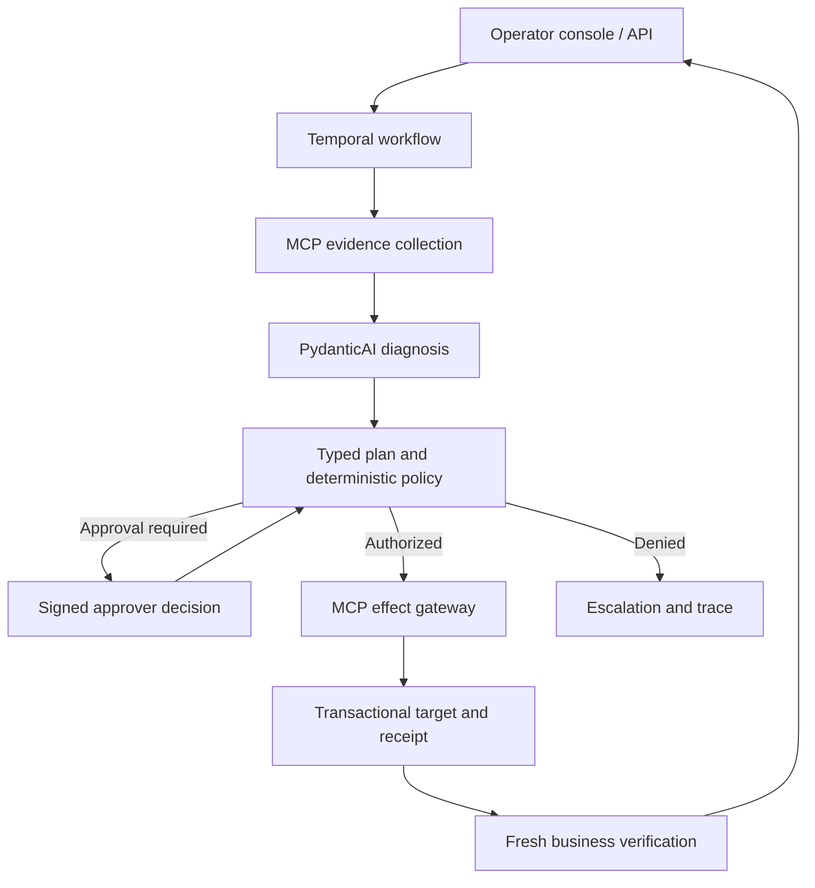

# Governed DataOps Agents

An incident-response console for a synthetic industrial data platform. It collects evidence, proposes a typed action, checks deterministic policy, obtains a bound approval when needed, executes through a durable workflow, and rereads the business state before reporting an outcome.

I built this project to make agent decisions inspectable. The console shows the incident, observations, diagnosis, proposed action, permission decision, approval and correlated execution trace. The target holds actual source, curated and quarantine rows. A successful tool response alone cannot close an incident as resolved.

**Current status:** the implementation is being qualified. The local model is experimental and has not demonstrated an advantage over the deterministic runbook. Development failures are retained; they are not replaced by a fallback. Read the [qualification ledger](docs/QUALIFICATION.md) and [evaluation method](docs/EVALUATION.md) before interpreting any capability as accepted. [Issue #1](https://github.com/mehdisafer/governed-dataops-agents/issues/1) tracks the remaining acceptance criteria.

## What the system does

| Incident | Observed business state | Governed response | Expected outcome |
|---|---|---|---|
| Freshness objective exceeded | Pending valid rows and an overdue freshness watermark | Load the reviewed partition once | Resolved after fresh row and watermark checks |
| Transient ingestion failure | Failed batch with a recorded transient interruption | Retry the fixed batch handler once | Resolved; lost responses reconcile against the receipt |
| Incompatible schema | Source schema differs from the accepted version | Refuse automated schema migration | Denied and referred to engineering |
| Rejected quality batch | Invalid source row in a rejected batch | Require separate approval, then quarantine the batch | Contained; source quality still requires repair |
| Duplicate delivery risk | The batch is already present in curated data but delivery remains pending | Prove row equivalence, then suppress redelivery | Resolved without inserting duplicate rows |

The model has no shell, SQL connection or write tool. Its category and action are proposals. The policy and target independently verify scope, environment, catalogue version, revision, preconditions and budgets. A changed plan or changed state invalidates an approval.

## Architecture



Temporal owns durable ordering, signals, timeouts and retries. MCP is the narrow capability transport. PydanticAI calls the configured model and validates its structured response. SQLite WAL stores the single-host synthetic business state, approvals, observations and effect receipts. The model is local llama.cpp serving a pinned community Qwen quantization through an OpenAI-compatible protocol; it is not an OpenAI-hosted deployment.

See [architecture and decisions](docs/ARCHITECTURE.md), [SDK compatibility](docs/COMPATIBILITY.md), the [versioned catalogue](src/governed_dataops/catalogue-v1.json) and [JSON contracts](contracts/v1).

## Start the private console

The reference profile is Linux amd64, Python 3.12, uv 0.13.6, Docker Engine and Docker Compose. Allow 12 GiB RAM, eight CPU threads and 15 GiB disk for the full demonstration. These are deployment allowances, not measured throughput claims.

```bash
uv sync --frozen
uv run dataops init
export DATAOPS_UID="$(id -u)"
export DATAOPS_GID="$(id -g)"
docker compose build
docker compose up -d --wait --wait-timeout 180
```

Open [http://127.0.0.1:8080](http://127.0.0.1:8080). Enter the value from your local `.secrets/operator-token` file. Select an incident class and a diagnostic engine. The deterministic runbook is the explicit baseline; the local model remains experimental. A quality incident requires the separate `.secrets/approver-token` credential before quarantine. The console clears credential inputs and keeps credentials only in the current tab's memory.

Initialization refuses to overwrite existing credentials. Only the API port is published, on loopback. Worker, target, model and Temporal use an internal network. The signing private key is mounted only into the API; the worker receives public verification material and reader/executor credentials. Follow the full [deployment instructions](docs/DEPLOYMENT.md) for permissions, secrets, resource limits, optional Terraform ownership and cleanup.

### API example

This creates an isolated synthetic target and submits a runbook incident. The response contains the stable incident and workflow identifiers.

```bash
uv run python - <<'PY'
from pathlib import Path
import httpx

token = Path('.secrets/operator-token').read_text().strip()
response = httpx.post(
    'http://127.0.0.1:8080/api/demo/incidents',
    headers={'Authorization': f'Bearer {token}'},
    json={'scenario': 'transient', 'mode': 'runbook', 'simulate_lost_response': True},
    timeout=30,
)
response.raise_for_status()
print(response.json())
PY
```

`POST /api/incidents` accepts an explicit versioned incident and an execution mode. Incident content and execution intent are admitted in one transaction. Duplicate event submissions reuse the durable workflow ID; rebinding an event to different content or mode is rejected. `GET /api/incidents/{id}` exposes the scoped trace. `POST /api/incidents/{id}/approval` requires the reviewed plan fingerprint and an approver credential. `POST /api/incidents/{id}/cancel` requests cancellation without promising rollback of an already dispatched effect. The runtime exposes its OpenAPI contract at `/openapi.json`.

## Reproduce the evidence

Fast checks use real SQLite and cryptography. Tests that use fake Temporal/provider boundaries label that scope; they do not establish service integration.

```bash
uv sync --frozen
uv run ruff check .
uv run pytest -q
uv run python scripts/export_contracts.py
git diff --exit-code -- contracts
```

For native real-service qualification, download the pinned runtime assets and run the supervisor from a clean source commit:

```bash
python scripts/bootstrap_runtime.py --destination var/runtime
uv run playwright install chromium
uv run python scripts/qualify.py \
  --manifest var/runtime/provisioning.json \
  --output evidence/runs/local-integration \
  --profile integration \
  --source-commit "$(git rev-parse HEAD)"
```

The supervisor runs communicating services and clients in one network namespace. It generates temporary role credentials outside the evidence directory, records the source/input/runtime identities, executes the scenarios, retains original histories and traces, and shuts down its processes. It refuses to overwrite an existing result directory. Any failed requested gate results in a nonzero exit; independent checks continue so a model failure does not hide a recovery failure.

Profiles are `smoke`, `integration`, `governance`, `evaluation` and `load`. `governance` exercises the platform with the explicitly selected runbook and does not start a model. `evaluation` runs the frozen held-out corpus in both modes. `load --count 12 --concurrency 4` measures bounded runbook throughput, not model scalability. Exact thresholds, denominators and limitations are described in [EVALUATION.md](docs/EVALUATION.md).

## Operations and limitations

- [Operations](docs/OPERATIONS.md): readiness, metrics, actionable alerts, bounded queues, recovery, paired backup/restore, migration and rollback.
- [Security](docs/SECURITY.md): role boundaries, signed approvals, injection assumptions, scan coverage and disclosure.
- [Third-party components](docs/THIRD_PARTY.md): pinned provenance, inventories and unresolved licence decisions.
- [Evidence](evidence/README.md): retained original results and their scope.
- [Delivery plan](docs/PLAN.md): acceptance criteria and reconstruction history.

This is a private single-host demonstration over synthetic data. The Temporal development server, shared SQLite volume and trusted application processes do not provide hostile-tenant isolation or an HA production deployment. The local model can be wrong even when its JSON and citations are valid. Atomic effect/receipt behavior is specific to the provided target; it is not a generic exactly-once guarantee for external APIs. A paired backup is only considered exercised when a restore is executed and its business state checked.

The repository's own licence has not been selected. It stays private pending an explicit maintainer decision and publication review. Third-party software and weights retain their own licences. No client data, personal computer access or external paid provider is used.
