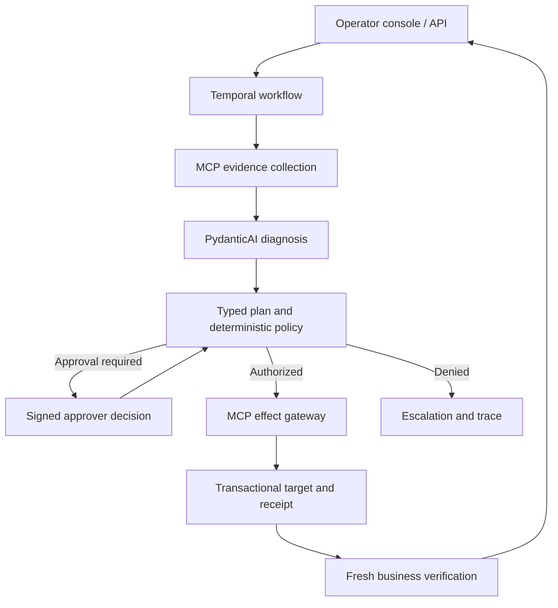

# Governed DataOps Agents

An incident-response console for a synthetic industrial data platform. It collects evidence, proposes a typed action, checks deterministic policy, obtains a bound approval when needed, executes through a durable workflow, and rereads the business state before reporting an outcome.

I built this project to make agent decisions inspectable. The console shows the incident, observations, diagnosis, proposed action, permission decision, approval and correlated execution trace. The target holds actual source, curated and quarantine rows. A successful tool response alone cannot close an incident as resolved.

**Earlier guarded-source checkpoint (17 November 2026): this repository is public, Apache-2.0, with an executed synthetic single-host governance/Temporal reference, including opt-in two-queue partition routing and trusted-snapshot diagnosis guards. The full agent-value V1 acceptance remains withheld.**

[PR #14](https://github.com/mehdisafer/governed-dataops-agents/pull/14) integrated deterministic target-to-queue routing, transactional partition admission and wrong-worker refusal; actual two-queue Temporal qualification exercised a stopped owner, a buffered signed approval and independent progress under saturated admission. [PR #15](https://github.com/mehdisafer/governed-dataops-agents/pull/15) added real SQLite/Ed25519 cross-partition approval and ownership denial tests. These establish **bounded admission, history and target isolation on the single-host reference**, not independent model throughput, dynamic resharing, hostile-tenant or multi-host guarantees.

[PR #13](https://github.com/mehdisafer/governed-dataops-agents/pull/13) merged a **fail-closed diagnosis validation guard** into `main` at [`9635dbccfe8cfd168f14ee9380eeb1f03e105a0c`](https://github.com/mehdisafer/governed-dataops-agents/commit/9635dbccfe8cfd168f14ee9380eeb1f03e105a0c). It rejects model category/action proposals contradicted by the typed snapshot **without choosing a runbook fallback or granting tools**. The exact [post-merge GitHub Actions run #43988865699](https://github.com/mehdisafer/governed-dataops-agents/actions/runs/43988865699) passed **core (272 Python tests), governance, real containers and infrastructure**. CircleCI `build-and-test` and `publication-security` also passed. **`model-evaluation` FAILED**: original downloaded comparison records **agent 7/10 strict**, **runbook 10/10**, 10/10 complete model responses, no observed unjustified effects and no measured advantage. Three impossible proposals (heldout-05, -06, -10) escalated with zero effects, which is **security containment, not a correct diagnosis**.

The earlier independent agent scores **2/10** (native) and **1/10** (hosted) remain historical evidence, not scores to average or retroactively relabel. Qwen remains experimental. The [V1 acceptance issue #1](https://github.com/mehdisafer/governed-dataops-agents/issues/1) stays open; no stable released/production claim is made.

## Latest source integration and acceptance — 17 November 2026

**Current public `main` source:** [`263a6c1c7226`](https://github.com/mehdisafer/governed-dataops-agents/commit/263a6c1c72260c7be6ba7ba7aeb1a4a891b7f41f), after merging [PR #17](https://github.com/mehdisafer/governed-dataops-agents/pull/17). The PR-head `e81309b300b579f60298b77d6202ac67ea843ae4` and its GitHub Actions merge preview `158e52c5d01515b77aec3f62d12b19e81c9db72e` share **identical Git tree `77c18f708010dc51687d5e6022000eb6a05f4d18`**. [Exact-tree PR workflow #43990582623](https://github.com/mehdisafer/governed-dataops-agents/actions/runs/43990582623) finished with **Core SUCCESS (284 Python tests and Ruff), Governance SUCCESS (including actual two-queue Temporal recovery), Containers SUCCESS (all 10 platform checks), Infrastructure SUCCESS; model-evaluation FAILED**. Both source-bound CircleCI `build-and-test` and `publication-security` were SUCCESS.

The frozen evaluation returned **agent 6/10 strict cases** versus **runbook 10/10**, with ten model responses actually observed, three agent business resolutions versus six runbook resolutions, and **no measured advantage**. The original [model-evaluation artifact #14288370568](https://github.com/mehdisafer/governed-dataops-agents/actions/runs/43990582623/artifacts/14288370568) was downloaded and inspected. Its agent median/nearest-rank p95 case wall times were **25.63055s / 43.323s**, versus **4.5788s / 9.059s** for the runbook; interrupted/unreported usage and compute costs must not be replaced with zero. The previous **7/10** at guarded `9635dbcc`, unguarded **7/10** at `8ab185f`, and older **2/10** and **1/10** results are distinct original runs. Do not infer improvement or degradation from these unpaired differences.

**Qualified provenance correction:** the original [container artifact #14288017124](https://github.com/mehdisafer/governed-dataops-agents/actions/runs/43990582623/artifacts/14288017124) reports initial Docker stack startup **18.442006s**, active *restored* stack startup **17.568490s** and a corrected `model-latency.json` measurement of **17.568490s** for the actually used stack. Agent gate duration was **69.936369s** and `Agent.run` inclusive of transport/native output validation **67.004099s**; client semaphore wait **0.000020s** and independent typed-business validation **0.000023s**. Internal llama.cpp queue, inference-only and model-only readiness remain **null/unobserved**. The real model response was observed, but **`diagnostic_quality_passed=false`**. No model, prompt, 90s deadline, provider, authority rule, target effect or release tag was changed in this instrumentation PR.

**Boundary:** this is a qualified synthetic single-host **platform/observability improvement**, *not* a full agent-value V1 acceptance, a prospective v2 evaluation, model throughput isolation or production deployment. The [V1 acceptance issue #1](https://github.com/mehdisafer/governed-dataops-agents/issues/1) and [latency issue #16](https://github.com/mehdisafer/governed-dataops-agents/issues/16) remain open. The separate **post-merge `main` push workflow #43992090061** must be evaluated by its own completed job conclusions; PR-head results must not be silently called mainline CI PASS.

## Historical hosted executions — 15–17 November 2026

These are separate executions, linked to their actual source commits. They do not rewrite the earlier native qualification or establish an accepted stable release.

| Gate | Evidence | Limit |
|---|---|---|
| Historical scoped-admission qualification (PR #10 source) | [PR #10](https://github.com/mehdisafer/governed-dataops-agents/pull/10), exact [GitHub Actions run 43976640653](https://github.com/mehdisafer/governed-dataops-agents/actions/runs/43976640653): Core 247 tests, governance 12 checks, containers 10 checks and infrastructure **PASS**; model-evaluation **FAIL** | Source-level per-(environment, scope) atomic admission; shared Temporal queue/model capacity, no partition reassignment, and no LLM advantage acceptance |
| Historic CircleCI unit and lint (`2460012`) | [`2460012` `build-and-test` success](https://app.circleci.com/workflow/9f31433c-2712-467c-89be-34ad2c3285c8/job/9d5fd2e8-3c67-4a35-861c-6feb9a735ea7) | Unit workflow, not container or model evaluation |
| Hosted governance and browser | [`924dd24` source/governance checks succeeded](https://github.com/mehdisafer/governed-dataops-agents/commit/924dd24780b332b13f24a5394a725ad2c55888ba) | Runbook-governed single-host reference, not agent advantage |
| Actual model, Temporal and Docker reference | [`cad9cc6` container workflow succeeded](https://app.circleci.com/workflow/15f6d873-dc0d-4e83-8d20-d3abf1ec20c9) | Ten platform gates; model diagnosis incorrect |
| Frozen hosted model comparison | [`924dd24` model-evaluation failed](https://github.com/mehdisafer/governed-dataops-agents/commit/924dd24780b332b13f24a5394a725ad2c55888ba) | Agent 1/10 versus runbook 10/10 |
| GitHub Actions full runtime on `7b709ff` | [Run #43919667084](https://github.com/mehdisafer/governed-dataops-agents/actions/runs/43919667084): `core`, `governance`, `containers`, `infrastructure` succeeded; **`model-evaluation` failed** | Real platform checks passed; frozen agent value remains failed and no production apply occurred |

A wrong model proposal rejected by trusted typed evidence and independent policy is a governance success, not a correct diagnosis. The newer independent PR #17 comparison also fails the diagnostic/value criterion, as documented in the latest source integration above. On `351817e`, the docs-only core ran **245 passing tests**, Ruff, a reviewed Gitleaks scan with 31 raw worktree and 62 raw historical candidates, and a dependency audit reporting no known vulnerabilities at query time. Python licence metadata was fully declared. Skipped jobs are not passes. See the [complete qualification ledger](docs/QUALIFICATION.md) and [CI provenance](docs/CI.md) for source-specific evidence and limitations.

## Historical native results — 14 November 2026

These results describe the clean, unchanged application source at [`f1e6e2f`](https://github.com/mehdisafer/governed-dataops-agents/commit/f1e6e2f3800242ec210145680261da8ab60f38b4), executed on 2026-11-14. Later qualification-harness and evidence-verifier corrections have separate regression checks; they do not rewrite this native result.

| Area | Observed result | Limit |
| --- | --- | --- |
| Business paths | All five runbook cases matched the expected row-based outcome | A containment or refusal is not a resolution |
| Governance and recovery | Tampered/stale/expired approval refusal, worker restart, model outage, contention and admission recovery exercised | Trusted single-host application processes and synthetic targets |
| Persistence | Paired application/Temporal restore executed; 56 closed current histories and 26 earlier development histories replayed | Earlier development source was dirty; replay covered a query-only workflow change |
| Frozen comparison | Runbook 10/10; agent 2/10; all twenty final business states observed | Two accepted model proposals were correct; eight absent responses failed the operational criterion |
| Bounded load | Twelve runbook incidents, concurrency four, p95 6.150 s, zero errors | This does not measure model throughput or multi-host scalability |
| Deployment and console on that original native host | Container, Terraform and rendered browser execution could not complete in the original environment | Later hosted results above supersede those environmental gaps only for their separate tested scopes |

The [qualification ledger](docs/QUALIFICATION.md) explains each result, the [evaluation report](docs/EVALUATION.md) preserves denominators and usage uncertainty, and the [evidence index](evidence/README.md) links the original artifacts. The [prioritized backlog](docs/BACKLOG.md) records the remaining work without changing the acceptance criteria.

## What the system does

| Incident | Observed business state | Governed response | Expected outcome |
|---|---|---|---|
| Freshness objective exceeded | Pending valid rows and an overdue freshness watermark | Load the reviewed partition once | Resolved after fresh row and watermark checks |
| Transient ingestion failure | Failed batch with a recorded transient interruption | Retry the fixed batch handler once | Resolved; lost responses reconcile against the receipt |
| Incompatible schema | Source schema differs from the accepted version | Refuse automated schema migration | Denied and referred to engineering |
| Rejected quality batch | Invalid source row in a rejected batch | Require separate approval, then quarantine the batch | Contained; source quality still requires repair |
| Duplicate delivery risk | The batch is already present in curated data but delivery remains pending | Prove row equivalence, then suppress redelivery | Resolved without inserting duplicate rows |

The model has no shell, SQL connection or write tool. Its category and action are proposals. The policy and target independently verify scope, environment, catalogue version, revision, preconditions and budgets. A changed plan or changed state invalidates an approval.

## Architecture



Temporal owns durable ordering, signals, timeouts and retries. MCP is the narrow capability transport. PydanticAI calls the configured model and validates its structured response. SQLite WAL stores the single-host synthetic business state, approvals, observations and effect receipts. The model is local llama.cpp serving a pinned community Qwen quantization through an OpenAI-compatible protocol; it is not an OpenAI-hosted deployment.

See [architecture and decisions](docs/ARCHITECTURE.md), [SDK compatibility](docs/COMPATIBILITY.md), the [versioned catalogue](src/governed_dataops/catalogue-v1.json) and [JSON contracts](contracts/v1).

## Start the private console

The reference profile is Linux amd64, Python 3.12, uv 0.13.6, Docker Engine and Docker Compose. Allow 12 GiB RAM, eight CPU threads and 15 GiB disk for the full demonstration. These are deployment allowances, not measured throughput claims.

The reference container was subsequently exercised in an isolated hosted Linux VM at `cad9cc6`; its ten platform checks passed while the diagnostic quality check failed. The commands below are reproducible starting steps for an authorized host, not a production deployment certificate. Follow the [deployment guide](docs/DEPLOYMENT.md) for evidence and resource limits.

```bash
uv sync --frozen
uv run dataops init
export DATAOPS_UID="$(id -u)"
export DATAOPS_GID="$(id -g)"
docker compose build
docker compose up -d --wait --wait-timeout 240
```

Open [http://127.0.0.1:8080](http://127.0.0.1:8080). Enter the value from your local `.secrets/operator-token` file. Select an incident class and a diagnostic engine. The deterministic runbook is the explicit baseline; the local model remains experimental. A quality incident requires the separate `.secrets/approver-token` credential before quarantine. The console clears credential inputs and keeps credentials only in the current tab's memory.

Initialization refuses to overwrite existing credentials. Only the API port is published, on loopback. Worker, target, model and Temporal use an internal network. The signing private key is mounted only into the API; the worker receives public verification material and reader/executor credentials. Follow the full [deployment instructions](docs/DEPLOYMENT.md) for permissions, secrets, resource limits, optional Terraform ownership and cleanup.

### API example

This creates an isolated synthetic target and submits a runbook incident. The response contains the stable incident and workflow identifiers.

```bash
uv run python - <<'PY'
from pathlib import Path
import httpx

token = Path('.secrets/operator-token').read_text().strip()
response = httpx.post(
    'http://127.0.0.1:8080/api/demo/incidents',
    headers={'Authorization': f'Bearer {token}'},
    json={'scenario': 'transient', 'mode': 'runbook', 'simulate_lost_response': True},
    timeout=30,
)
response.raise_for_status()
print(response.json())
PY
```

`POST /api/incidents` accepts an explicit versioned incident and an execution mode. Incident content and execution intent are admitted in one transaction. Duplicate event submissions reuse the durable workflow ID; rebinding an event to different content or mode is rejected. `GET /api/incidents/{id}` exposes the scoped trace. `POST /api/incidents/{id}/approval` requires the reviewed plan fingerprint and an approver credential. `POST /api/incidents/{id}/cancel` requests cancellation without promising rollback of an already dispatched effect. The runtime exposes its OpenAPI contract at `/openapi.json`.

## Reproduce the evidence

Fast checks use real SQLite and cryptography. Tests that use fake Temporal/provider boundaries label that scope; they do not establish service integration.

```bash
uv sync --frozen
uv run ruff check .
uv run pytest -q
uv run python scripts/export_contracts.py
git diff --exit-code -- contracts
```

For native real-service qualification, download the pinned runtime assets and run the supervisor from a clean source commit:

```bash
python scripts/bootstrap_runtime.py --destination var/runtime
uv run playwright install chromium
uv run python scripts/qualify.py \
  --manifest var/runtime/provisioning.json \
  --output evidence/runs/local-integration \
  --profile integration \
  --source-commit "$(git rev-parse HEAD)"
```

The supervisor runs communicating services and clients in one network namespace. It generates temporary role credentials outside the evidence directory, records the source/input/runtime identities, executes the scenarios, retains original histories and traces, and shuts down its processes. It refuses to overwrite an existing result directory. Any failed requested gate results in a nonzero exit; independent checks continue so a model failure does not hide a recovery failure.

Profiles are `smoke`, `integration`, `governance`, `evaluation` and `load`. `governance` exercises the platform with the explicitly selected runbook and does not start a model. `evaluation` runs the frozen held-out corpus in both modes. `load --count 12 --concurrency 4` measures bounded runbook throughput, not model scalability. Exact thresholds, denominators and limitations are described in [EVALUATION.md](docs/EVALUATION.md).

For isolated real-container qualification against a clean source commit:

```bash
uv run python scripts/qualify_container.py \
  --source-commit "$(git rev-parse HEAD)" \
  --output evidence/runs/container-current --model-cpus 4
```

The container platform gate separately records `diagnostic_quality_passed`. A real model response can be incorrect even when the container execution succeeds. Always use a fresh output directory and preserve unsuccessful original records.

## Operations and limitations

- [CI provenance](docs/CI.md): CircleCI unit execution, separate manual container qualification and GitHub Actions limitations.
- [Operations](docs/OPERATIONS.md): readiness, metrics, actionable alerts, bounded queues, recovery, paired backup/restore, migration and rollback.
- [Fixed target partitions](docs/PARTITIONING.md): opt-in queue ownership, scoped admission reservations and real-worker qualification.
- [Security](docs/SECURITY.md): role boundaries, signed approvals, injection assumptions, scan coverage and disclosure.
- [Third-party components](docs/THIRD_PARTY.md): pinned provenance, inventories and unresolved licence decisions.
- [Evidence](evidence/README.md): retained original results and their scope.
- [Delivery plan](docs/PLAN.md): implementation milestones, acceptance status and reconstruction history.
- [Backlog](docs/BACKLOG.md): model/runtime investigation, evaluation design and remaining deployment gates.

This is a **single-host, locally network-isolated demonstration** over synthetic data. The Temporal development server, shared SQLite volume and trusted application processes do not provide hostile-tenant isolation or an HA production deployment. The local model can be wrong even when its JSON and citations are valid. Atomic effect/receipt behavior is specific to the provided target; it is not a generic exactly-once guarantee for external APIs. A paired backup is only considered exercised when a restore is executed and its business state checked.

The maintainer has explicitly selected the [Apache License, Version 2.0](LICENSE) for this repository's original source. **GitHub reports this source repository public (16 November 2026).** Public visibility is separate from the non-public runtime, complete agent-quality acceptance, branch protections and an eventual release tag. Third-party software and weights retain their own licences. The reproducible incident fixtures use synthetic data; the reference does not require access to a personal workstation, a client environment or an external paid inference provider.
