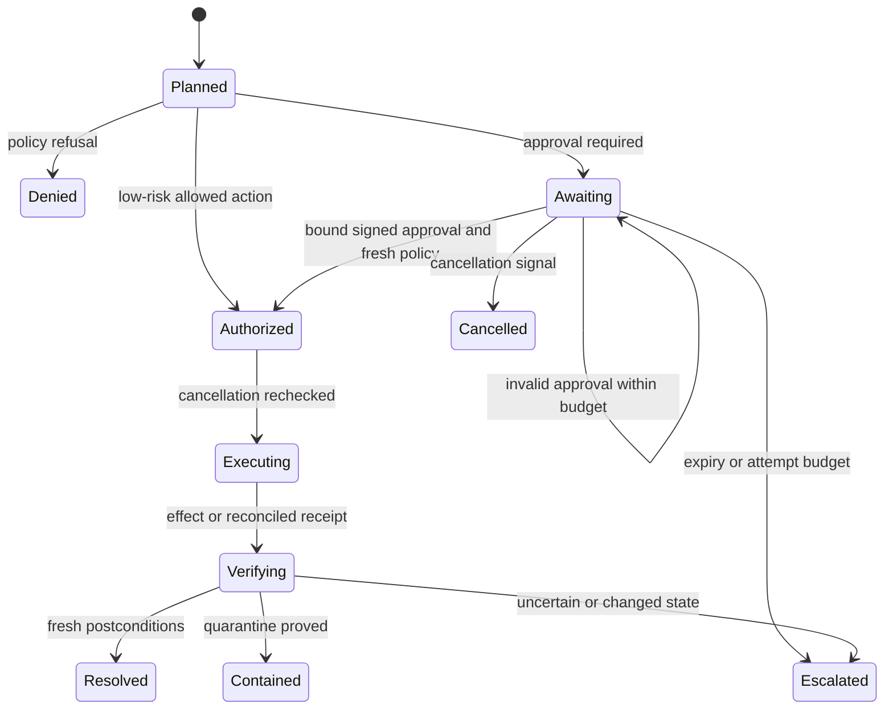

# Architecture and decisions

## Product boundary

The product is a governed response to a synthetic industrial data incident. The operator must be able to inspect the observations, diagnosis, proposed action, authorization, approval, effect receipt and fresh business verification. Each case has a concrete row-level target state. The result distinguishes resolved data, contained quality failures, refused actions, escalation and cancellation.

The model's contribution is a proposed diagnosis and action. It cannot grant itself a capability, approve its own plan or invoke a write tool. The deterministic runbook uses the same evidence, catalogue, policy, workflow and target. Keeping those downstream components identical makes the diagnostic comparison meaningful.

## Components and state ownership

| Component | Responsibility | State or boundary |
|---|---|---|
| Operator API | Authenticate roles, scope incident access, admit work, sign reviewed approvals, signal workflows | No remediation loop; incident and execution intent admitted transactionally |
| Browser console | Display real traces and submit explicit operator/approver decisions | Text-only rendering, same-origin requests, credentials in tab memory |
| Temporal workflow | Order activities, bound retries and approval time, accept approval/cancel signals, persist terminal result | Durable histories; no model, HTTP or database calls inside workflow code |
| Activities | Collect, diagnose, authorize, execute, verify and record | External I/O lives here; bounded worker and model capacity |
| MCP gateway/server | Fixed stdio capability transport with typed requests/results | Fixed Python module executable, narrow child environment, no generic shell |
| Diagnostic provider | PydanticAI structured output over the configured local model | No tools, no implicit proxy/redirect/provider fallback, at most two requests |
| Policy | Enforce roles, scope, environment, version, preconditions, approval and budgets | Reviewed code; rationale text is never authority |
| Synthetic target | Own source/curated/quarantine rows and effect ledger | One SQLite transaction commits the business mutation and receipt |

The single-host reference uses two durable stores: application/target SQLite and the Temporal development server's SQLite. They have separate backup and recovery responsibilities. Shared application volume access means application processes are trusted. Signatures are valuable provenance checks but do not prevent a malicious database administrator from changing rows directly.

## Incident and execution identity

An incident carries a contract version, incident ID, event ID, target, environment, scope, symptom and ingress timestamp. The API persists the incident and selected diagnostic mode/fault-injection intent in one transaction. A unique event/incident identity is immutable after admission, apart from a repeated ingress timestamp. Admission and capacity checks occur under `BEGIN IMMEDIATE`.

Temporal uses `dataops-{incident_id}` and `REJECT_DUPLICATE` workflow ID reuse. A start acknowledgement can be lost after Temporal accepts the request. The API retains a dispatch-pending projection and a retry uses the same identity. It never intentionally starts a new workflow under a new ID to conceal an uncertain dispatch.

An incident's terminal state is monotonic in the read projection. Late audit events remain visible but cannot reopen a resolved, contained, denied, escalated or cancelled incident.

## Plans, catalogue and policy

The versioned catalogue names fixed operations, environments, permissions, risk, preconditions, postconditions and budgets. A plan references the catalogue and policy versions, exact evidence ID, expected target revision, target/scope/environment and action. Its SHA-256 digest is calculated over canonical sorted JSON.

Catalogue v1 permits exactly one action and an action budget of one, with delegation depth at most one. No dynamic code is evaluated from catalogue metadata. Schema migration exists as a proposed action so a schema problem can be explained, but the executable policy always refuses it. The target has no schema-migration effect handler.

Policy runs before approval, after approval and immediately before effect dispatch. The target repeats the checks inside its write transaction and compares the stored evidence snapshot to its current state. These repeated checks address specific stale-state windows between proposal, human approval, workflow scheduling and execution.

## Approval lifecycle

The API derives approver identity from its configured credential. It signs plan digest, incident, target, scope, environment, expected revision, policy version, identity and issuance/expiry with Ed25519. The target requires both a valid signature and the exact persisted envelope. The executor cannot sign because it does not receive the private key or approver credential.

The persisted awaiting-approval projection is sufficient for the API to accept a decision while workers are stopped. Fresh target evidence is still mandatory. The signal is stored by Temporal and processed when a worker resumes. If its delivery acknowledgement is uncertain, the API redelivers the same signed envelope; workflow signal deduplication does not consume another approval attempt. At execution time, expiry and target revision are checked again.

Cancellation before dispatch prevents an effect. Cancellation after dispatch cannot establish that nothing happened; reconciliation and verification still run. The console and API state this limitation.

## Effects and ambiguous responses

The idempotency key is SHA-256 of incident ID, canonical plan digest and action index. The target executes a reviewed handler and writes its receipt in one transaction. Retrying an already committed key returns that receipt without repeating the mutation. A concurrent plan for the same target is protected by target revision checks and SQLite write serialization.

Each execution activity reconciles the receipt **before** evaluating potentially stale state. This order matters after a successful effect: the effect itself advances the revision, so a blind precondition check would otherwise reject its own retry without discovering the receipt.

The real response-loss fixture commits the effect and then returns HTTP 503. The MCP boundary marks the outcome uncertain; the activity reads the durable receipt before any repeat. If neither effect nor absence can be established, it escalates. This is target-specific atomicity, not a distributed transaction across arbitrary services.

Verification rereads target state through MCP. It checks the expected revision transition, policy version, batch status, source/curated/quarantine conditions, freshness and duplicate invariants. Qualification additionally compares actual row IDs and amounts and checks the effect-ledger cardinality.

## Capacity and failure handling

Admission capacity, Temporal queueing, worker activity slots, per-process model semaphores, model-server decoding slots and target write serialization are separate controls. The admission maximum is now counted transactionally for each authenticated **(environment, scope)** rather than across every scope stored in SQLite: saturating one scope returns HTTP 429 there, while another scope can still enter its own bounded queue. Concurrent admissions to one scope cannot overbook the last slot. Global event/incident identities and their intent binding remain unchanged. Duplicate retries remain idempotent. Model queue acquisition is bounded, activity retry/time budgets are finite and the model has no delegation loop.

**Partition routing is not thereby qualified:** all accepted incidents still use the configured Temporal task queue and worker/model capacity. A busy scope can continue to delay other scopes at those shared execution layers. No partition ownership handoff, per-partition worker queue or latency isolation is claimed by the new admission-only tests.

The target is intentionally a single local SQLite authority. Adding a second worker is tested for contention and duplicate suppression; it does not establish horizontal database scalability. Partitioned production targets would need an explicit ownership and idempotency contract per partition before these guarantees could be generalized.

An unavailable model, invalid output or incomplete evidence yields abstention/escalation. The baseline is never called as an implicit repair of a model failure. Local-provider monetary charge is recorded separately from unmeasured CPU, memory, energy and human intervention.

## Changes and replay

The `incident-v1` Temporal patch marker records the orchestration baseline. Keep external I/O in activities and avoid changing recorded command order without a versioning strategy. Replay retained histories using the candidate worker before deployment. A same-build replay proves compatibility with those exact histories; a code-upgrade claim must identify the earlier and later source manifests.

Database schema v1 is packaged as an explicit SQL migration. The application rejects a database with a newer migration version. Rollback uses a stopped, paired application/Temporal restore and matching signing identity; there is no destructive automatic down-migration. See [OPERATIONS.md](OPERATIONS.md).

## Decisions retained

| Decision | Reason | Consequence |
|---|---|---|
| Temporal is the only workflow authority | Durable signals, timers and replay are part of the product | No second task orchestrator or home-grown durable loop |
| SQLite target with atomic receipts | Real reproducible effects without client/cloud systems | Single-host scope; stronger deployments need separate qualification |
| Local pinned model, optional explicit external route | Reproducible privacy and bounded provider cost | Small quantized model quality is a measured limitation |
| Independent deterministic baseline | Avoid inflated agent claims | An agent can fail to improve on the runbook; that result stays visible |
| Finite catalogue and one effect | Make authority and failure recovery auditable | Unsupported operations escalate rather than becoming arbitrary code |
| Paired stopped backup | Avoid claiming inconsistent online recovery | Maintenance downtime is required by the reference procedure |

SDK contracts and primary source references are recorded in [COMPATIBILITY.md](COMPATIBILITY.md). Deployment provenance and third-party rights are recorded in [DEPLOYMENT.md](DEPLOYMENT.md) and [THIRD_PARTY.md](THIRD_PARTY.md).
